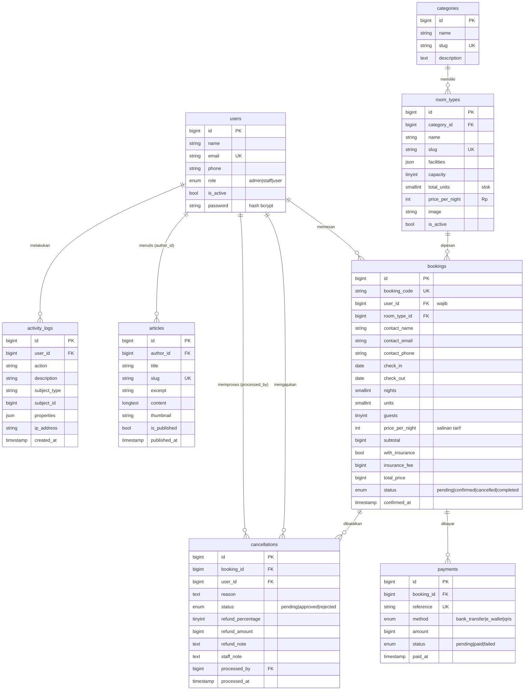

# Dokumentasi Database

Aplikasi Manajemen Reservasi Glamping — Kelompok Kelas B
Stack: Laravel + MySQL. Penanggung jawab database: Fais.

## ERD

GitHub otomatis menampilkan blok `mermaid` di atas sebagai gambar diagram.

## Ringkasan tabel

| Tabel | Isi | Dipakai modul |
|---|---|---|
| `users` | Akun admin, staff, user | Marcel (auth, manajemen akun), semua modul |
| `categories` | Kategori kamar (Safari Tent, Kabin, Dome) | Fais |
| `room_types` | Jenis kamar, stok unit, tarif per malam | Fais, Hafiz (cek ketersediaan) |
| `bookings` | Reservasi | Hafiz, Thoni (profil, dashboard) |
| `payments` | Pembayaran dummy | Hafiz, Thoni (pendapatan) |
| `cancellations` | Pengajuan pembatalan + refund | Thoni |
| `articles` | Artikel | Fais |
| `activity_logs` | Catatan tindakan staff/admin | Marcel (halaman log), dipanggil semua modul |

## Aturan bisnis yang tercermin di database

Semua angka ada di `config/glamping.php`, jangan ditulis ulang di controller.

**Status booking**

| Status | Arti | Menahan unit? |
|---|---|---|
| `pending` | Sudah dibuat, belum bayar | Ya |
| `confirmed` | Sudah bayar | Ya |
| `cancelled` | Pembatalan disetujui staff | Tidak |
| `completed` | Tamu sudah check-out | Tidak |

**Ketersediaan unit.** Unit terpakai = jumlah `units` dari booking `pending`/`confirmed` yang tanggalnya beririsan, yaitu `check_in < check_out_diminta` dan `check_out > check_in_diminta`. Tanggal check-out tidak dihitung menginap. Gunakan `$roomType->availableUnits($checkIn, $checkOut)`.

**Reservasi wajib login.** Pengunjung yang belum punya akun harus register dulu. Karena itu `bookings.user_id` wajib diisi. Kolom `contact_*` tetap ada sebagai data kontak saat reservasi (default diambil dari profil, boleh diubah) dan dipakai untuk cek booking. Akun yang sudah punya booking tidak bisa dihapus (`restrictOnDelete`); admin menonaktifkannya lewat `is_active`.

**Biaya.** `subtotal = price_per_night × nights × units`. Asuransi = 10% dari subtotal. `total_price = subtotal + insurance_fee`.

**Refund pembatalan.** "Lebih dari 3 hari" = selisih hari kalender antara tanggal pengajuan dan tanggal check-in lebih dari 3 (minimal 4 hari).

| | Batal > 3 hari sebelum check-in | Batal ≤ 3 hari |
|---|---|---|
| Dengan asuransi | 100% | 50% |
| Tanpa asuransi | 50% | 0% |

Gunakan `$booking->refundPercentageAt(now())`.

**Saat pembatalan disetujui:** `cancellations.status = approved`, `bookings.status = cancelled` (unit otomatis tersedia lagi karena booking `cancelled` tidak dihitung), `refund_note` diisi, `processed_by` dan `processed_at` diisi, lalu catat ke `activity_logs`.

**Satu pengajuan aktif.** Satu booking boleh punya beberapa baris pembatalan (misal ditolak lalu diajukan lagi), tetapi aplikasi harus menolak pengajuan baru jika masih ada yang `pending`.

## Helper di model

| Method | Fungsi |
|---|---|
| `User::isAdmin()`, `isStaff()`, `canAccessDashboard()` | Cek role |
| `RoomType::availableUnits($in, $out)` | Sisa unit untuk rentang tanggal |
| `Booking::generateCode()` | Kode booking unik, format `GLM-XXXXXX` |
| `Booking::scopeHoldingUnits()`, `scopeOverlapping()` | Query ketersediaan |
| `Booking::refundPercentageAt($tanggal)` | Persentase refund |
| `ActivityLog::record($aksi, $deskripsi, $model)` | Catat tindakan staff/admin |

## Data seeder

`php artisan migrate:fresh --seed` membuat:

- 3 akun demo wajib + 1 staff tambahan + 6 user tamu
- 3 kategori, 5 jenis kamar
- 3 artikel terbit
- ±60 booking dalam rentang 90 hari ke belakang sampai 30 hari ke depan, termasuk booking yang check-in hari ini
- Pembatalan pending, approved, dan rejected beserta log aktivitas staff
- `user@demo.test` punya booking selesai, booking akan datang (bisa dicoba dibatalkan), pembatalan menunggu, dan pembatalan disetujui

Tanggal data dummy dihitung dari hari seeder dijalankan, jadi dashboard selalu punya data terbaru.
